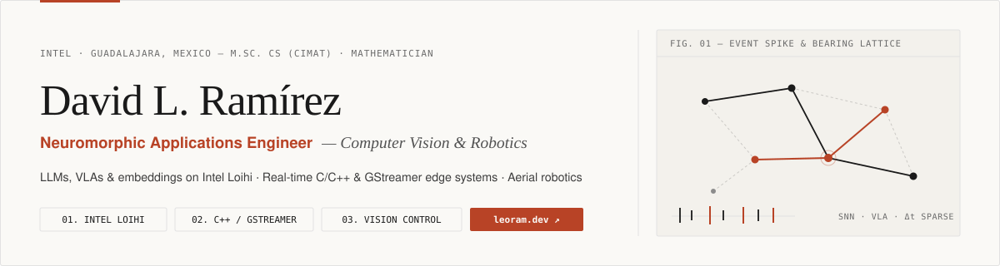

  <a href="https://leoram.dev" target="_blank" rel="noopener noreferrer">
    <picture>
      <source media="(prefers-color-scheme: dark)" srcset="./docs/assets/banner-dark.svg" />
      <source media="(prefers-color-scheme: light)" srcset="./docs/assets/banner-light.svg" />
      
    </picture>
  </a>

 

  <a href="https://leoram.dev" target="_blank" rel="noopener noreferrer"><strong>01. Portfolio (leoram.dev) ↗</strong></a>
  &nbsp;&nbsp;—&nbsp;&nbsp;
  <a href="https://doi.org/10.3390/robotics13080115" target="_blank" rel="noopener noreferrer"><strong>02. MDPI Robotics Paper ↗</strong></a>
  &nbsp;&nbsp;—&nbsp;&nbsp;
  <a href="https://www.linkedin.com/in/david-leonardo-ramirez-parada/" target="_blank" rel="noopener noreferrer"><strong>03. LinkedIn ↗</strong></a>
  &nbsp;&nbsp;—&nbsp;&nbsp;
  <a href="mailto:deiividramirez@gmail.com"><strong>04. deiividramirez@gmail.com</strong></a>

---

### 01. Overview

Mathematician and Computer Science M.Sc. ([CIMAT](https://www.cimat.mx/)) based in Guadalajara, Mexico, working across neuromorphic architectures, embedded computer vision, and multi-robot control.

- **Intel Corporation** *(Jun 2026 — Present)* — **Neuromorphic Applications Engineer** adapting Large Language Models (LLMs), Vision-Language-Action (VLA) models, and vector embeddings for event-driven execution on **Intel Loihi**.
- **Tecnológico de Monterrey** *(Aug 2024 — Present)* — **Adjunct Professor** teaching undergraduate computer science and engineering courses.
- **Introid Inc.** *(Jan 2024 — Jun 2026)* — **AI Software Developer** building real-time C/C++ and Python vision systems on NVIDIA Jetson and Qualcomm boards alongside custom **GStreamer** plugins and video pipelines.

---

### 02. Selected Publication

**Vision-Based Formation Control of Quadrotors Using a Bearing-Only Approach**  
**David L. Ramírez-Parada**, Héctor M. Becerra, Carlos A. Toro-Arcila, and Gustavo Arechavaleta  
*Robotics* (MDPI), Vol. 13, No. 8, 115, July 2024 — [**DOI: 10.3390/robotics13080115 ↗**](https://doi.org/10.3390/robotics13080115)

Decoupled monocular visual servoing and scale-invariant bearing-only formation control enabling multi-quadrotor teams to navigate constrained apertures without global position estimation.

---

### 03. Technical Specifications

| Index | Domain | Core Stack |
| :--- | :--- | :--- |
| `01.` | **Neuromorphic & ML** | `Intel Loihi` · `LLMs & VLAs` · `Vector Embeddings` · `Event-Driven SNNs` · `PyTorch` · `TensorFlow / TFLite` · `Quantization` |
| `02.` | **Systems & Hardware** | `C++` · `C` · `Python` · `ARM Architecture` · `NVIDIA Jetson` · `Qualcomm SoCs` · `Embedded Linux` · `Docker` · `Git` |
| `03.` | **Vision & Robotics** | `GStreamer` · `OpenCV` · `ROS / ROS 2` · `Gazebo` · `Visual Servoing` · `Nonlinear Control` · `MATLAB` · `PostgreSQL` |

---

  <picture>
    <source media="(prefers-color-scheme: dark)" srcset="https://raw.githubusercontent.com/deiividramirez/deiividramirez/output/github-contribution-grid-snake-dark.svg" />
    <source media="(prefers-color-scheme: light)" srcset="https://raw.githubusercontent.com/deiividramirez/deiividramirez/output/github-contribution-grid-snake.svg" />
    
  </picture>

